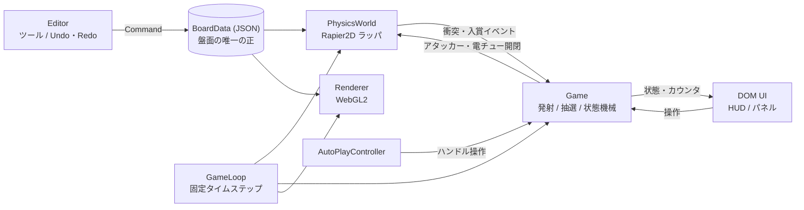
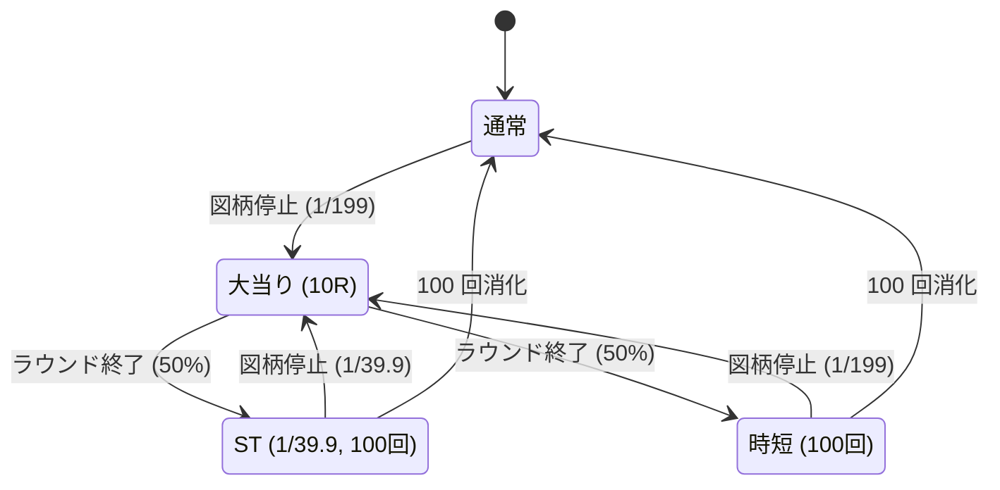

# 実装計画書: 猫耳キャラ パチンコ (ブラウザ版)

- 元資料: [PLAN.md](PLAN.md)
- 素材: [pachi.png](pachi.png) / [character.png](character.png)
- 作成日: 2026-09-23

---

## 1. 概要

### 1.1 ゴール

`Docs/pachi.png` (`character.png` のキャラクターをテーマにしたパチンコ台の画像) を盤面として使い、物理シミュレーションで玉が動くパチンコをブラウザ上でプレイできる Web アプリを作る。

### 1.2 要件と対応

| # | 要件 (PLAN.md) | 本計画での対応 |
|---|---|---|
| R1 | 壁や釘などのオブジェクトの位置調整・追加ができるエディット機能 | Phase 4 で実装し、Phase 5 のデフォルト盤面作成にも使う |
| R2 | 指定した玉数・時間のあいだ自動で打ち続ける自動プレイ機能 | Phase 7 |
| R3 | TypeScript | 全コードを TypeScript (strict) で書く |
| R4 | WebGL | 描画はすべて自前の WebGL2 レンダラで行う |
| R5 | 物理エンジン | Rapier 2D (WASM) |
| R6 | git で機能・フェーズごとにコミット | §8 のフェーズ計画に沿ってコミットする |

### 1.3 素材の分析

- **pachi.png**: 1123×1401 px、RGB (アルファなし)。筐体の前面全体が描かれていて、遊技領域は中央の円形枠の内側にある。**釘と玉は描かれていない**ので、釘・玉は WebGL で描画する。壁 (レール・役物の外周) は、画像に描かれた透明レールの位置に当たり判定だけを重ねる。
- **character.png**: 1080×1920 px。大当り時のカットインなど演出素材に使う。

画像上の主な要素と座標の目安 (画像ピクセル座標、左上が原点)。割り当ては仮で、Phase 5 でエディタを使って確定する。

| 画像上の要素 | 位置の目安 (x, y) | 割り当て (仮) |
|---|---|---|
| 円形枠の内側 | x 95–1030, y 230–1150 | 遊技領域 (物理シミュレーション範囲) |
| 中央液晶 (キャラ絵) | x 240–800, y 250–870 | センター役物。外周を壁にし、内側は図柄の表示エリア |
| 「大当り確率 1/199」 | (165, 690) | スペック表記。通常時の大当り確率は 1/199 とする |
| 「BONUS」ロゴ | (540, 980) | ステージ兼装飾。大当り時に発光させる |
| 「START」 | (548, 1083) | ヘソ (スタートチャッカー) |
| 右ルートのハート | (930, 640) | 普図ゲート |
| ハートと LUCKY の間 | (900, 800) 付近 | 電チュー (普通電動役物) |
| 「LUCKY」 | (852, 1005) | 大入賞口 (アタッカー、右打ち) |
| 下部中央のボタン | (575, 1245) | 演出ボタン (装飾、任意) |
| 右下のピンクの円形部 | (925, 1250) | 発射ハンドルの UI を重ねる |

---

## 2. 技術選定

| 領域 | 採用 | バージョン | 理由 |
|---|---|---|---|
| 言語 | TypeScript (strict) | 6.0 系 | 要件。7.0 が最新だが、typescript-eslint 8.x の対応範囲が `<6.1.0` なので 6.0 系に固定する |
| ビルド / 開発サーバ | Vite | 8.x | HMR が速い。静的ビルドで配布でき、画像や WASM、`?raw` によるシェーダ読込も扱いやすい |
| 描画 | WebGL2 自前レンダラ (描画ライブラリなし) | — | 描くものは背景テクスチャ・円 (玉/釘)・線 (壁)・スプライトだけ。インスタンシングを使えば数百〜数千個を少ないドローコールで描けるので、薄い自前層で足り、挙動も制御しやすい |
| 物理 | Rapier 2D (`@dimforge/rapier2d-deterministic-compat`) | 0.20 | CCD (連続衝突判定) で、小さく速い玉が釘や薄い壁をすり抜けるのを防げる。WASM なので速い。決定論ビルドなので同じシードで同じ結果になり、テストや自動プレイの検証に向く。`-compat` は WASM を base64 で内包しているので、バンドラの設定がいらない |
| 単体テスト | Vitest | 5.x | Vite と設定を共有できる |
| E2E テスト | Playwright | 1.6x | `.gitignore` に設定済み。WebGL の描画をスクリーンショットで確認する |
| 静的解析 | ESLint (typescript-eslint) + Prettier | ESLint 10 | |

採用しなかった案:

- Matter.js: CCD がなく、高速な玉が釘や薄い壁をすり抜けやすい。
- PixiJS / Three.js: この用途には抽象化が過剰。WebGL を直接扱うほうが見通しがよい。

実行環境はデスクトップの最新 Chrome / Edge を主な対象とし、Firefox でも動作を確認する。

---

## 3. アーキテクチャ

### 3.1 全体構成



設計方針:

1. **BoardData を盤面の唯一の正とする**。物理ワールドも描画も BoardData から作る。エディタは BoardData を Command 経由でしか変更せず、変更後に物理ワールドを作り直す (盤面は数百オブジェクト程度なので、全体を作り直しても一瞬で終わる)。
2. **ゲーム内の時間はすべてシミュレーション時間で数える**。変動時間・ラウンド時間・発射間隔などを実時間ではなくシミュレーション時間で数えるので、早送りしてもゲームの進行が破綻しない。
3. **乱数はシード付き**。抽選と発射のばらつきにはシード付き PRNG を使う。固定タイムステップと組み合わせると、同じシード・同じ盤面なら同じ結果が出る。
4. **ロジックと描画を分ける**。`game/`・`physics/`・`board/` は DOM や WebGL に依存させず、Node 上の Vitest でテストできるようにする。

### 3.2 座標系

| 座標系 | 単位 | 用途 |
|---|---|---|
| 盤面座標 | 画像ピクセル (左上原点、y は下向き) | BoardData の保存形式とエディタでの編集。画像と直接重ね合わせられる |
| 物理座標 | cm (y は下向き、重力は +y 方向) | Rapier 内部。玉の半径は 0.55 cm で、Rapier の既定の許容誤差に合う大きさ |
| スクリーン座標 | CSS px | ポインタ入力と DOM オーバーレイ |
| クリップ座標 | −1〜1 | シェーダ |

盤面座標と物理座標の換算は `pxPerCm` (初期値 21.6 = 画像幅 1123px を筐体幅約 52cm とみなした値) で行う。この値は BoardData に持たせ、調整できるようにする。Camera は盤面座標とスクリーン座標の変換、アスペクト比を保ったフィット表示、エディタでのズーム・パンを受け持つ。

### 3.3 ゲームループ

```ts
// 1 フレームの処理 (概略)
const FIXED_DT = 1 / 240;               // 物理ステップ (s)
function frame(now: number) {
  const realDt = Math.min((now - last) / 1000, 0.1);
  acc += realDt * speed;                // speed: 1, 2, 5, 10, 最大
  let steps = 0;
  const t0 = performance.now();
  while (acc >= FIXED_DT && steps < MAX_STEPS && performance.now() - t0 < STEP_BUDGET_MS) {
    game.update(FIXED_DT);              // 発射タイマー・状態機械・演出タイマー
    physics.step();                     // Rapier の 1 ステップ
    game.handle(physics.drainEvents()); // 入賞・アウト・ゲート通過など
    acc -= FIXED_DT; steps++;
  }
  if (steps === MAX_STEPS || performance.now() - t0 >= STEP_BUDGET_MS) acc = 0; // 処理落ちの連鎖を防ぐ
  renderer.render(scene);               // 早送り中は描画を間引く
  requestAnimationFrame(frame);
}
```

### 3.4 ディレクトリ構成

```
Opus55CatgirlPachi/
├─ Docs/                     PLAN.md, 本書, 素材画像 (原本は変更しない)
├─ index.html
├─ package.json / tsconfig.json / vite.config.ts / eslint.config.js / playwright.config.ts
├─ src/
│  ├─ main.ts                エントリ: Rapier 初期化 → App 起動
│  ├─ app/                   App (play / edit / auto のモード管理), GameLoop
│  ├─ core/                  Vec2, EventBus, SeededRng, 座標変換, 定数
│  ├─ board/                 BoardData 型, バリデーション, スキーマ移行, 保存・読込
│  ├─ physics/               PhysicsWorld, コライダ生成, 衝突イベントの変換
│  ├─ render/
│  │  ├─ gl/                 コンテキスト, Shader, Buffer/VAO, Texture
│  │  ├─ shaders/            *.vert / *.frag (Vite の ?raw で読込)
│  │  ├─ Camera.ts
│  │  ├─ BackgroundLayer.ts  盤面画像
│  │  ├─ CircleBatch.ts      玉・釘 (インスタンス描画)
│  │  ├─ LineBatch.ts        壁・ガイド・選択枠 (太線を三角形ストリップで描く)
│  │  ├─ SpriteLayer.ts      液晶図柄・カットイン・エフェクト
│  │  └─ Renderer.ts         レイヤの合成
│  ├─ game/                  Launcher, BallManager, PocketRouter, Lottery, GameStateMachine, Payout, GameSpec
│  ├─ auto/                  AutoPlayController, AutoPlayStats, レポート出力
│  ├─ editor/                Editor, tools/, Selection, commands/, PropertyPanel
│  ├─ ui/                    HUD, ハンドル UI, 各パネル (DOM)
│  └─ assets/                pachi.png (Docs からコピー), boards/default.json
└─ tests/
   ├─ unit/                  純粋ロジック (Vitest)
   ├─ physics/               Node 上で Rapier を回す統合テスト (Vitest)
   └─ e2e/                   Playwright (スクリーンショットは Docs/screenshots/ へ出力。gitignore 済み)
```

---

## 4. データモデル

### 4.1 BoardData (盤面定義)

```ts
interface BoardData {
  schemaVersion: 1;
  name: string;
  image: { src: string; width: number; height: number }; // 1123 x 1401
  scale: { pxPerCm: number };                            // 21.6
  physics: PhysicsParams;                                // §5 の値
  playfield: Vec2[];                                     // 遊技領域の多角形。外に出た玉は回収する
  launcher: LauncherDef;                                 // 発射位置・方向・初速範囲
  objects: BoardObject[];
}

type BoardObject =
  | { id: string; type: 'nail';     x: number; y: number; r: number }
  | { id: string; type: 'wall';     points: Vec2[]; closed: boolean; material: 'rail' | 'plastic' | 'rubber' }
  | { id: string; type: 'windmill'; x: number; y: number; r: number; blades: number; damping: number }
  | { id: string; type: 'pocket';   kind: PocketKind; rect: RotRect; payout: number; lid?: RotRect }
  | { id: string; type: 'gate';     rect: RotRect }
  | { id: string; type: 'display';  rect: RotRect };  // 液晶図柄の表示領域 (物理なし)

type PocketKind = 'start' | 'electric' | 'attacker' | 'general' | 'out' | 'foul';
interface RotRect { x: number; y: number; w: number; h: number; angle: number }
```

- `lid` を持つ入賞口 (電チュー・アタッカー) は、閉じているあいだ蓋のコライダを有効にして入賞を塞ぐ。開放は蓋のコライダを無効にするだけで表す。
- `foul` は発射レールのファール口。勢いが足りず戻ってきた玉は持ち玉に返す。
- 保存時に `schemaVersion` を記録し、読込時にバリデーションとスキーマ移行を通す。不正な JSON はエラーを表示して読込を拒否する。

### 4.2 GameSpec (遊技スペック)

画像の「1/199」に合わせたライトミドル風の簡易スペック。すべて設定値として持ち、コードに直接書かない。

| 項目 | 既定値 |
|---|---|
| 大当り確率 (通常時 / 時短中) | 1/199 |
| 大当り確率 (ST 中) | 1/39.9 |
| 大当り後の振り分け | ST 100 回 (50%) / 時短 100 回 (50%) |
| ラウンド | 10R。1R は 10 カウントまたは 29.5 秒で終了 |
| 賞球 | ヘソ 3 / 電チュー 1 / 一般入賞口 10 / アタッカー 15 |
| 保留 | 最大 4 個 (特図 1・特図 2 は区別しない簡略モデル) |
| 変動時間 | 通常ハズレ 6–10 秒、リーチ 15–30 秒、保留 3 個以上で短縮 3 秒、時短・ST 中 1.5–3 秒 |
| 普図 | ゲート通過で抽選。通常時は当選 1/10 で 0.2 秒開放、電サポ中は当選 9/10 で 3 秒開放 |
| 貸玉 | 1000 円 = 250 玉 (4 円パチンコ) |
| 初期持ち玉 | 1000 玉 (設定で変更可) |

### 4.3 保存

- 盤面: 編集中は localStorage に自動保存する。JSON ファイルへのエクスポートとインポート、デフォルト盤面へのリセットを用意する。
- デフォルト盤面: `src/assets/boards/default.json` (Phase 5 で作成してコミット)。
- 設定 (音量・表示・自動プレイの前回値): localStorage。

---

## 5. 物理パラメータの初期値

すべて `BoardData.physics` に持たせ、デバッグパネルから調整できるようにする。値は実機の寸法を基にした初期値で、Phase 3・5 で調整する。

| パラメータ | 初期値 | 備考 |
|---|---|---|
| 玉の半径 / 質量 | 0.55 cm / 5.5 g | 実機の 11mm・5.5g。画像上では直径約 24px |
| 釘の半径 (当たり判定) | 0.09 cm | 描画では頭を少し大きく描く |
| 重力 | 980 cm/s² (+y) | 盤面の傾きは係数で調整できるようにする |
| 線形減衰 | 0.1 | 盤面・ガラスとの摩擦を近似 |
| 反発係数 | 玉–釘 0.55、玉–壁 0.3、玉–ゴム 0.7、玉–玉 0.7 | 組み合わせ規則はコライダごとに指定する |
| 摩擦係数 | 0.1–0.2 | |
| タイムステップ | 1/240 s | 玉に CCD を有効化。すり抜けが出るなら 1/480 s に下げる |
| 発射 | 100 発/分 (0.6 秒間隔)、初速 250–520 cm/s、ばらつき ±1.5% | 強度 0–100% を曲線で初速に変換する |
| 同時に存在できる玉の上限 | 300 | 超えたら発射を止める |
| 滞留判定 | 速度 < 1 cm/s が 5 秒続いたら回収 | 玉が挟まって自動プレイが止まるのを防ぐ保険 |

Rapier 上での表現:

- 玉: 動的剛体 + 円コライダ (CCD 有効)
- 釘: 固定の円コライダ
- 壁: 固定のポリラインコライダ
- 風車: 動的剛体 + 回転ジョイント (玉に押されて自由に回る)
- 入賞口・ゲート・アウト口: センサーコライダ。衝突イベントをコライダハンドル経由でオブジェクト ID に変換する

---

## 6. 機能仕様

### 6.1 プレイ

**画面構成**: 盤面画像を縦方向にフィットさせて表示し、右側 (幅が足りない場合は下側) に HUD パネルを置く。

**発射操作**:

- 強度: 画像右下のハンドル部に重ねたダイヤルをドラッグして回す。マウスホイール、↑↓キー、HUD のスライダーでも調整できる。
- 発射: Space を押しているあいだ、またはハンドルを押さえているあいだ発射する。「発射固定」トグル (F キー) を ON にすると押し続けなくてよい。
- 弱いと左ルートに落ち、中程度だと天釘付近に入り、強いと右ルート (右打ち) に届く。大当り中と電サポ中は HUD に「右打ち」を表示する。

**玉の流れ**: 発射すると持ち玉が 1 減る。入賞すると賞球が加算される。アウト口に入った玉は消える。ファール玉は持ち玉に戻す。

**抽選と遊技状態**:



- ヘソ・電チューへの入賞で保留が 1 増え (最大 4)、保留があれば図柄の変動を始める。抽選は入賞した時点で行う (先読み演出に使える)。
- 大当り中はアタッカーの蓋を開閉し、ラウンドごとに入賞数と時間を数える。
- ST・時短中は電サポ (普図が高確率・長開放) になる。

**液晶演出**:

- 液晶エリアの下部に、3 リールの図柄 (数字 + 肉球) を半透明で重ねて表示する。
- リーチ演出、大当り時の character.png カットイン、ラウンド表示を行う。
- 図柄は Canvas2D で描いてテクスチャにし、WebGL の矩形に貼る。テクスチャは内容が変わったときだけ更新する。

**HUD**: 持ち玉、投資額、回転数 (前回大当りから / 累計)、大当り回数、遊技状態、保留ランプ、右打ち表示、貸玉ボタン、デバッグ用の「強制大当り」(開発ビルドのみ)。

### 6.2 エディット機能 (R1)

**モード**: E キーまたはボタンでプレイとエディットを切り替える。エディット中は物理を止める。「テスト発射」(T キー) を押すと、その場の盤面で物理だけを動かして確認できる。

**ツール**:

| ツール | キー | 動作 |
|---|---|---|
| 選択・移動 | V | クリックで選択。Shift で追加選択。ドラッグで移動。何もない所からドラッグすると矩形選択 |
| 釘 | N | クリックした位置に釘を置く |
| 釘列 | L | 2 点を指定して直線上に等間隔で置く。3 点指定で円弧上に置くこともできる。本数またはピッチを入力する |
| 壁 | W | クリックで頂点を追加し、Enter またはダブルクリックで確定。Shift を押すと 45° 単位にスナップ |
| 頂点編集 | 壁を選択して A | 頂点のドラッグ・追加・削除 |
| 風車 | M | クリックで配置 |
| 入賞口・ゲート | P | 種類 (ヘソ / 電チュー / アタッカー / 一般 / アウト / ゲート) を選んで矩形を描く |
| 発射装置・液晶領域 | — | プロパティパネルで編集 |

**共通操作**:

- Undo / Redo: Ctrl+Z / Ctrl+Y (Command パターンで実装)
- 削除: Delete
- コピー / ペースト / 複製: Ctrl+C / Ctrl+V / Ctrl+D
- 微調整: 矢印キーで 1px、Shift+矢印で 10px
- グリッドスナップ: G で ON/OFF。グリッド幅は設定で変更
- ズーム: ホイール。パン: Space+ドラッグまたは中ボタンドラッグ
- プロパティパネル: 選択したオブジェクトの座標・半径・反発材質・賞球数などを数値で編集する

**表示オプション**: 背景画像の不透明度、当たり判定の表示、グリッドの表示、釘間隔の表示。釘を 2 本選択すると、中心間の距離と隙間を mm で表示し、玉 (11mm) が通れるかどうかを色で示す。釘調整に使う。

**保存**: localStorage への自動保存、JSON のエクスポート・インポート、デフォルトへのリセット。インポート時にはバリデーションを行う。

**警告表示**: 遊技領域の外にあるオブジェクトや、釘同士の重なりを検出して一覧に出す。

### 6.3 自動プレイ機能 (R2)

**設定**:

| 項目 | 内容 |
|---|---|
| 停止条件 | 発射数 N 発、時間 T、またはその両方 (先に達したほうで停止)。手動停止はいつでもできる |
| 時間の定義 | ゲーム内時間 (シミュレーション時間)。等倍なら実時間と同じ。早送りすると「T 分打った結果」を短い実時間で得られる |
| ハンドル | 左打ちの強度と右打ちの強度を指定する。遊技状態に応じた自動切替 (大当り・電サポ中は右打ち) を ON/OFF できる |
| 持ち玉切れ | 自動で貸玉する (投資の上限額を指定) か、停止する |
| 速度 | 1x / 2x / 5x / 10x / 最大 (描画を間引いて CPU の許す限り進める) |
| シード | 固定 (再現用) またはランダム |

**実行中**: 進捗バー (残り発射数・残り時間)、一時停止・再開・停止、リアルタイムの統計を表示する。

**結果レポート**:

| 指標 | 定義 |
|---|---|
| 発射数 | ファールで戻った玉は除く |
| 回転数 / 大当り回数 / 初当り回数 | |
| 回転率 | 通常時の使用玉 (発射数 − 通常時の賞球) を 250 玉 = 1000 円に換算し、千円あたりの回転数を出す |
| 総賞球 / 差玉 / 出玉率 | 差玉 = 総賞球 − 発射数、出玉率 = 総賞球 ÷ 発射数 |
| 入賞口別の入賞数 | ヘソ・電チュー・アタッカー・一般 |
| 持ち玉推移グラフ | Canvas2D で描画 |
| エクスポート | JSON / CSV |

**釘調整の流れ**: エディタで釘を動かす → 同じシードで自動プレイ → 回転率を比べる。この流れを想定して、エディタから自動プレイを直接起動できるようにする。

---

## 7. レンダリング

描画順 (手前が後):

| 順 | レイヤ | 内容 |
|---|---|---|
| 1 | 背景 | pachi.png (ミップマップ付きテクスチャ) |
| 2 | 液晶 | 図柄リール、カットイン (character.png) |
| 3 | 壁 | プレイ中は非表示。エディット中と当たり判定表示中だけ描く |
| 4 | 釘 | 影 → 金属の頭 (インスタンス描画) |
| 5 | 風車 | 回転するスプライト |
| 6 | 玉 | 金属球のシェーダ。球面の法線で背景テクスチャをずらしてサンプリングし、盤面のピンクが映り込むように見せる。鏡面ハイライトも加える |
| 7 | エフェクト | 入賞時のパーティクル、大当り時のフラッシュ (加算合成) |
| 8 | エディタのオーバーレイ | グリッド、選択枠、ハンドル。寸法ラベルは DOM で出す |

実装上の要点:

- 円は、インスタンスごとの属性 (位置・半径・色・種別) を持つ四角形に SDF で描き、`fwidth` でアンチエイリアスをかける。玉の位置は毎フレーム `bufferSubData` で更新する。
- devicePixelRatio に対応する (上限 2)。ResizeObserver でキャンバスの大きさに追従する。
- `webglcontextlost` / `webglcontextrestored` を受けて GPU リソースを作り直す。
- WebGL2 が使えない環境では案内メッセージを表示する。

---

## 8. フェーズ計画とコミット計画

各フェーズの終わりに、型チェック・lint・単体テストを通し (E2E があるフェーズでは E2E も)、スクリーンショットで確認してからコミットする。ブランチは `master` に直接コミットする。コミットメッセージは Conventional Commits の書式で、説明は日本語で書く。

規模感: S = 小、M = 中、L = 大。

### マイルストーン

| MS | 範囲 | 到達点 |
|---|---|---|
| M1 | Phase 0–3 | 玉を打てる |
| M2 | Phase 4–5 | 盤面を編集でき、画像と当たり判定が一致している |
| M3 | Phase 6 | ゲームとして遊べる |
| M4 | Phase 7 | 自動プレイが使える |
| M5 | Phase 8–9 | 仕上げと総合テスト |

### Phase 0: プロジェクト基盤 [S]

- Vite (vanilla-ts テンプレート相当) で初期化する。TypeScript strict、パスエイリアス `@/`。
- ESLint、Prettier、Vitest、Playwright を導入する。
- npm scripts: `dev` / `build` / `preview` / `typecheck` / `lint` / `test` / `test:e2e`。
- `Docs/pachi.png` と `Docs/character.png` を `src/assets/` にコピーする。

**完了条件**: `npm run dev` で空のページが開く。`build` / `typecheck` / `lint` / `test` が通る。

**コミット**: `chore: Vite + TypeScript + テスト環境をセットアップ`

### Phase 1: WebGL レンダリング基盤 [M]

- `gl/` ユーティリティ: コンテキスト生成、シェーダのコンパイル (エラーログ付き)、Buffer/VAO、テクスチャの読込。
- Camera: アスペクト比を保ったフィット表示、DPR 対応、リサイズへの追従、盤面座標とスクリーン座標の変換。
- BackgroundLayer、CircleBatch (インスタンス描画)、LineBatch。
- DOM レイアウト (キャンバスとサイドパネル)。

**完了条件**:

- pachi.png がアスペクト比を保って表示され、リサイズに追従する。
- テスト用の円と線を描ける。
- Playwright のスクリーンショットで、キャンバスが空でないことを確認できる。

**コミット**: `feat(render): WebGL2 レンダラ基盤と盤面画像の描画を追加`

### Phase 2: 物理エンジン統合と盤面データモデル [M]

- Rapier を非同期で初期化する。
- PhysicsWorld: BoardData からワールドを作る。玉の追加・削除、1 ステップ進める処理、衝突イベントを型付きイベントに変換する処理を持つ。
- BoardData の型、バリデーション、盤面座標と物理座標の換算。
- 固定タイムステップの GameLoop と SeededRng。
- 仮の盤面 (外枠と数十本の釘) を用意する。クリックした位置に玉を落とせるようにし、当たり判定をデバッグ表示する。

**完了条件**:

- クリックで落とした玉が釘で跳ね、下端で回収される。
- 単体テスト (座標換算・ループ・乱数) が通る。
- 物理の統合テスト (最高速の玉を壁に当ててもすり抜けない) が通る。

**コミット**: `feat(physics): Rapier2D を統合し盤面データモデルを定義`

### Phase 3: 発射装置と玉・釘の描画 [M]

- Launcher: 強度から初速への変換曲線、100 発/分、シード付きのばらつき、ファール玉の返却。
- 発射レール、外レール、内レールを画像に合わせてざっくり置く。
- BallManager: 玉のプール、生成から回収まで、滞留した玉の回収、同時に存在できる玉の上限。
- 玉 (金属球シェーダ) と釘 (金属の頭と影) の描画。
- ハンドル UI (画像右下のダイヤル、ホイール、キー操作、発射固定) と持ち玉カウンタ。
- 物理パラメータの初期調整。

**完了条件**:

- 強度によって玉の到達位置が単調に変わる (弱いと左に落ち、強いと右打ちに届く)。
- 1 分間に 100 発打てる。
- すり抜けが起きない。

**コミット**: `feat(game): 発射装置と玉・釘の描画を実装`

### Phase 4: エディット機能 [L]

作業量が多いので、3 回に分けてコミットする。

**4-1 基盤**

- モード切替、オブジェクト ID の管理、選択・移動・矩形選択。
- Command パターンの Undo/Redo、ズーム・パン、グリッドスナップ、矢印キーでの微調整。
- 変更のたびに物理ワールドを作り直す (デバウンスあり)。

コミット: `feat(editor): 選択・移動・Undo/Redo のエディタ基盤を追加`

**4-2 ツール**

- 釘・釘列・壁・頂点編集・風車・入賞口・ゲートの各ツール。
- プロパティパネル、コピー・複製・削除、釘間隔の表示、警告の一覧表示、テスト発射。

コミット: `feat(editor): 釘・壁・入賞口などの配置ツールとプロパティパネルを追加`

**4-3 保存**

- localStorage への自動保存、JSON のエクスポート・インポート (バリデーション付き)、デフォルトへのリセット。

コミット: `feat(editor): 盤面の保存・読込・エクスポート機能を追加`

**完了条件**:

- 釘・壁・入賞口を追加・移動・削除でき、Undo/Redo が効く。
- 保存してリロードすると元に戻る。
- エクスポートした JSON をインポートすると同じ盤面になる。
- Command の単体テストと、エディタ操作の E2E テストが通る。

### Phase 5: デフォルト盤面の作成 (画像との位置合わせ) [M]

- 背景の不透明度と当たり判定表示を使って、エディタで pachi.png をなぞる。
  - 外レール、内レール、センター役物の外周、ステージ、左右のルート
  - 釘: 天釘、道釘、寄り釘、ヘソの命釘、ジャンプ釘、風車、右ルートの釘
  - ヘソ (START)、普図ゲート (ハート)、電チュー、アタッカー (LUCKY)、一般入賞口、アウト口
- `src/assets/boards/default.json` として保存する。
- スクリーンショット (`Docs/screenshots/`) で、画像と当たり判定のずれを確認する。

回転率の最終調整は、Phase 7 の自動プレイで計測しながら行う。

**完了条件**:

- 画像と当たり判定が一致している (スクリーンショットで目視確認)。
- 左打ちでヘソに入賞し、右打ちで右ルートが機能する。

**コミット**: `feat(board): pachi.png に合わせたデフォルト盤面を作成`

### Phase 6: ゲームロジック (抽選・大当り・演出) [L]

- PocketRouter (入賞 → 賞球)、保留、Lottery、GameStateMachine (§6.1)、普図と電チューの開閉、アタッカーの開閉とラウンドの管理。
- 液晶の図柄変動、リーチ、大当り表示、character.png のカットイン。
- HUD 一式、貸玉、投資額の集計、デバッグ用の強制大当り。

**完了条件**:

- 単体テストが通る: 状態遷移の網羅、確率の統計検定 (10⁶ 回の抽選が許容範囲に収まる)、賞球の計算、保留の上限。
- 実際のプレイで「大当り → 10R → ST または時短 → 通常」が一通り動く。

**コミット** (2 回):

- `feat(game): 抽選・保留・大当りラウンドの状態機械を実装`
- `feat(render): 液晶図柄演出と大当りカットインを追加`

### Phase 7: 自動プレイ機能 [M]

- AutoPlayController (§6.3 の設定)、早送り (フレーム時間の予算内でステップを回し、描画を間引く)。
- 進捗表示と一時停止・再開・停止。
- 結果レポート (指標、グラフ、JSON / CSV)、エディタからの起動。
- デフォルト盤面の回転率を、実機並み (千円あたり 18–20 回程度) を目安に調整する。

**完了条件**:

- 1000 発を指定するとちょうど 1000 発で止まる。60 秒を指定するとゲーム内時間 60 秒で止まる。
- 10 倍速で動く。
- 同じシードと同じ盤面なら、統計が同じになる。

**コミット**:

- `feat(auto): 自動プレイ (玉数・時間指定、早送り、結果レポート) を実装`
- `chore(board): 自動プレイで計測してデフォルト盤面の釘を調整`

### Phase 8: 演出・仕上げ [M]

- 入賞時のパーティクル、大当り時のフラッシュ、枠ランプ風の発光 (加算合成)。
- 物理パラメータのデバッグパネル。
- パフォーマンス調整 (目標: 等倍で玉 200 個・釘 500 本を 60fps)。
- エラー表示 (WebGL2 非対応、WASM の初期化失敗)。
- README (起動方法と操作説明)。

**コミット**:

- `feat(fx): 入賞・大当り演出エフェクトを追加`
- `perf: 描画と物理ステップを最適化`
- `docs: README に起動方法と操作説明を追加`

### Phase 9: 総合テスト [S]

- E2E シナリオを整える: 起動 → 発射 → エディット → 保存 → 自動プレイ → レポート。
- Chrome / Edge / Firefox で動作を確認する。
- 長時間の自動プレイ (最大速度で 10 万発) を回し、メモリリークと玉の滞留がないことを確認する。

**コミット**: `test: E2E シナリオと長時間自動プレイの検証を追加`

---

## 9. テスト戦略

| 種別 | ツール | 対象 |
|---|---|---|
| 単体 | Vitest | 抽選の確率 (統計検定)、状態機械、賞球、保留、エディタの Command (実行・取消・やり直し)、BoardData のシリアライズ往復とスキーマ移行、座標変換、自動プレイの停止条件と統計、乱数 |
| 物理統合 | Vitest (Node 上で Rapier を実行) | すり抜けなし (最高速で 1000 発打っても、すべてがセンサーかアウトで回収され、範囲外に出ない)、強度と到達位置の単調性、決定論 (同じシードで同じ結果)、風車・蓋の開閉の動作 |
| E2E | Playwright (Chromium) | 起動時に描画されていること (ピクセル検査)、発射、エディタの追加・Undo・保存・リロード、自動プレイ 100 発の完了とレポート表示。スクリーンショットは `Docs/screenshots/` に出力 |
| 目視 | スクリーンショット | 画像と当たり判定のずれ、演出の見た目 |

ロジックを DOM や WebGL から切り離しておく (§3.1 の方針 4) ことで、テストの大半を Node 上で速く回せる。

---

## 10. リスクと対策

| リスク | 影響 | 対策 |
|---|---|---|
| 画像と当たり判定がずれる | 見た目と玉の動きが合わない | エディタの背景不透明度・当たり判定表示・ズームで合わせる。スクリーンショットで確認する |
| 高速な玉のすり抜け | 玉が盤外に出る、入賞しない | CCD、1/240 s のステップ (必要なら 1/480 s)、物理統合テストで検出する。範囲外の玉は回収する保険を入れる |
| 物理挙動が実機らしくない | 遊んで楽しくない、回転率が極端になる | パラメータを BoardData に持たせ、デバッグパネルで調整する。自動プレイで数値として評価する |
| 早送り時の CPU 負荷 | フレーム落ち、UI が固まる | フレームごとの時間予算、描画の間引き。必要なら物理と抽選を Web Worker に移す (設計上、ロジックは DOM に依存しない) |
| 玉の滞留 | 自動プレイが進まない | 滞留判定による回収 |
| Rapier の WASM 初期化 | 起動に失敗する | `-compat` 版で配信を単純にし、失敗時はエラーを表示する |
| TypeScript 7 と周辺ツールの非互換 | lint が動かない | TypeScript は 6.0 系に固定する。typescript-eslint が対応したら更新を検討する |

---

## 11. スコープ外 (将来の拡張候補)

- サウンド (Web Audio による効果音・BGM)
- スマートフォン・タッチ操作への最適化
- 特図 1・特図 2 の区別や、より複雑な実機スペック
- 盤面データのオンライン共有
- 自動プレイを Web Worker でヘッドレス実行し、さらに速くする

---

## 12. 確認事項

回答がなければ、本書の既定値で進める。

1. **ゲームスペック**: 1/199 以外の値 (ST・時短・ラウンド・賞球) は §4.2 の既定値でよいか。
2. **画像要素の割り当て**: ヘソ = START、右打ちでアタッカー = LUCKY、普図ゲート = ハートでよいか。
3. **自動プレイの「時間」**: ゲーム内時間 (等倍なら実時間と同じ) と解釈してよいか。
4. **対象環境**: デスクトップのブラウザだけを対象とし、サウンドとスマホ対応は範囲外でよいか。
5. **ブランチ運用**: リポジトリには `master` しかない。`master` にフェーズごとに直接コミットする運用でよいか。
