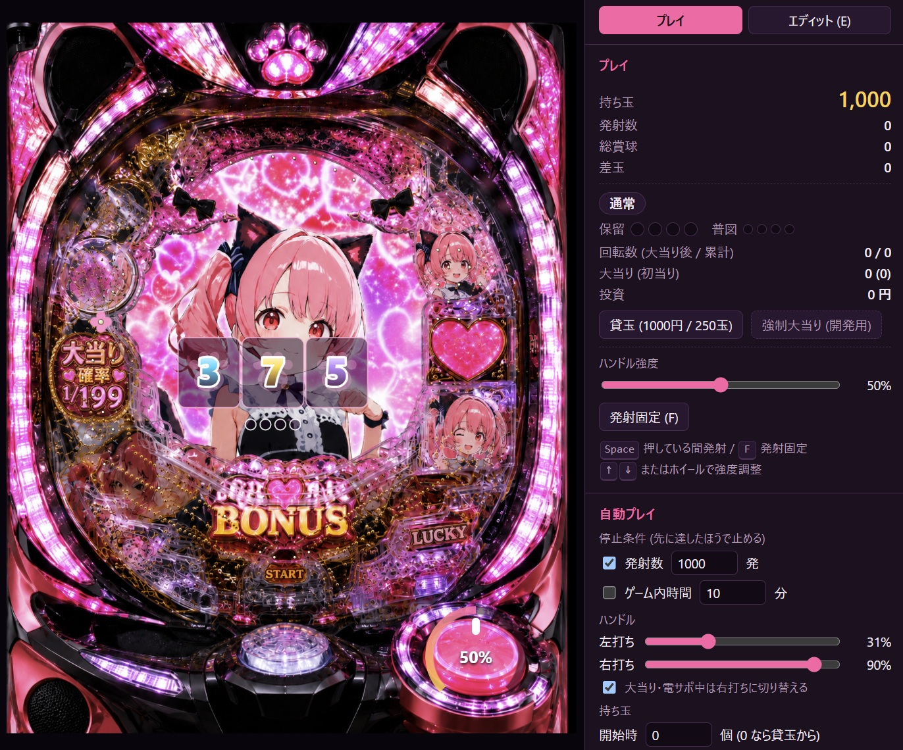

# ねこみみパチンコ (ブラウザ版)



遊べるページ: https://maoku.github.io/Opus55CatgirlPachi

画像から遊べるパチンコ台を作ってみるシリーズ

- https://github.com/Maoku/FableCatgirlPachi
- https://github.com/Maoku/GPT6AstraProCatgirlPachi


`Docs/pachi.png` の盤面画像を使って、ブラウザでパチンコを遊べる Web アプリです。
玉の動きは物理エンジンで計算し、描画はすべて WebGL2 で行います。

ユーザーからの指示は Docs/PLAN.md だけで、実装計画書を作らせ、実装を依頼するのみ。  
あとは出来上がった際に最低限の修正を入れているものです。  
なので生成AIモデルがどの程度パチンコ台とその遊びの仕組みを認識しているかがわかります。

- 釘・壁・入賞口などを配置・調整できる **エディット機能**
- 指定した玉数・時間だけ打ち続けて結果をまとめる **自動プレイ機能**
- 大当り 1/199、ST・時短、10 ラウンドの簡易スペックと、液晶の図柄演出・カットイン

技術: TypeScript (strict) / WebGL2 (自前レンダラ) / [Rapier 2D](https://rapier.rs/) (決定論ビルド) / Vite / Vitest / Playwright

計画と設計は [Docs/IMPLEMENTATION_PLAN.md](Docs/IMPLEMENTATION_PLAN.md) にあります。

## 起動方法

必要なもの: Node.js 20 以上、WebGL2 に対応したブラウザ (最新の Chrome / Edge / Firefox)

```bash
npm install
```

```bash
npm run dev
```

表示された URL (通常は http://localhost:5173) をブラウザで開きます。

静的ファイルとしてビルドする場合は `npm run build` を実行し、`dist/` を任意の Web サーバで配信します
(相対パスでビルドするので、サブディレクトリにも置けます)。

### npm scripts

| コマンド            | 内容                                  |
| ------------------- | ------------------------------------- |
| `npm run dev`       | 開発サーバ (HMR)                      |
| `npm run build`     | 型チェックと本番ビルド (`dist/`)      |
| `npm run preview`   | ビルド結果の確認                      |
| `npm run typecheck` | 型チェック                            |
| `npm run lint`      | ESLint                                |
| `npm run format`    | Prettier で整形                       |
| `npm test`          | 単体テストと物理の統合テスト (Vitest) |
| `npm run test:e2e`  | E2E テスト (Playwright)               |
| `npm run test:long` | 長時間の自動プレイ (10 万発)          |

## 遊び方

画面右のパネルの「プレイ」「エディット (E)」で、プレイとエディットを切り替えます。

### プレイ

| 操作                                                                | 内容                                                |
| ------------------------------------------------------------------- | --------------------------------------------------- |
| `Space` を押している間 / 右下のハンドルを押さえている間             | 発射 (100 発/分)                                    |
| `F` / 「発射固定」                                                  | 押し続けなくても発射し続ける                        |
| `↑` `↓` (`Shift` で 5%)、マウスホイール、ハンドルを回す、スライダー | 発射の強さ                                          |
| 「貸玉」                                                            | 1000 円で 250 玉を借りる                            |
| `Shift` + クリック                                                  | その位置に玉を落とす (デバッグ用。集計には含めない) |

- 弱く打つと左側に落ち、25% 前後でヘソ (START) を狙えます。強く打つと外レールを回って右側 (右打ち) に届きます。
- 大当り中と電サポ (ST・時短) 中は画面右上に「右打ち」と表示されます。
- ヘソ・電チューに入ると保留が増え (最大 4 個)、液晶の図柄が回ります。

#### スペック

| 項目       | 値                                                  |
| ---------- | --------------------------------------------------- |
| 大当り確率 | 1/199 (ST 中 1/39.9)                                |
| 大当り後   | ST 100 回 (50%) / 時短 100 回 (50%)                 |
| ラウンド   | 10R (10 カウントまたは 29.5 秒)                     |
| 賞球       | ヘソ 3 / 電チュー 1 / 一般入賞口 10 / アタッカー 15 |
| 普図       | 通常 1/10 で 0.2 秒開放、電サポ中 9/10 で 3 秒開放  |

値は `src/game/GameSpec.ts` にまとめてあります。

### 自動プレイ

プレイ画面の「自動プレイ」パネルで設定して「開始」を押します。

- 停止条件: 発射数 N 発、ゲーム内時間 T 分、またはその両方 (先に達したほうで止まります)。いつでも停止できます
- ハンドル: 左打ちと右打ちの強さ。大当り・電サポ中に右打ちへ自動で切り替えられます。実行中もパネルのスライダーや右下のハンドル・ホイール・`↑` `↓` で変えられ、いま打っている側の強さとして以後その値で打ち続けます
- 持ち玉が切れたとき: 投資の上限まで自動で貸玉するか、止めるか
- 速度: 1x (既定) / 2x / 5x / 10x / 最大 (時間はすべてゲーム内時間で数えるので、早送りしても結果は変わりません)
- シード: 固定すると、同じ盤面なら同じ結果になります (釘を調整して比べるときに使います)

終了すると結果レポート (回転数、大当り・初当り、千円あたりの回転率、差玉、出玉率、入賞口別の入賞数、持ち玉推移のグラフ) が表示され、JSON / CSV で保存できます。
エディット画面の「この盤面で自動プレイ」からも前回の設定で起動できます。

### エディット

エディット中は物理が止まります。`T` (テスト発射) を押すと、その場の盤面で玉を打って流れを確認できます。

| ツール         | キー | 操作                                                                                                      |
| -------------- | ---- | --------------------------------------------------------------------------------------------------------- |
| 選択・移動     | `V`  | クリックで選択、`Shift` で追加選択、ドラッグで移動、何もない所からドラッグで矩形選択                      |
| 釘             | `N`  | クリックで釘を置く                                                                                        |
| 釘列           | `L`  | 直線 (2 点) または円弧 (3 点) に、本数またはピッチを指定して並べる                                        |
| 壁             | `W`  | クリックで頂点を追加、`Enter` かダブルクリックで確定、`Shift` で 45° 単位                                 |
| 頂点編集       | `A`  | 壁の頂点をドラッグ、辺をダブルクリックで追加、`Delete` で削除 (遊技領域の多角形も編集可)                  |
| 風車           | `M`  | クリックで置く                                                                                            |
| 入賞口・ゲート | `P`  | 種類 (ヘソ / 電チュー / アタッカー / 一般 / アウト / ファール / 普図ゲート / 液晶領域) を選んで矩形を描く |

| 共通操作                 | キー                                                         |
| ------------------------ | ------------------------------------------------------------ |
| 元に戻す / やり直し      | `Ctrl+Z` / `Ctrl+Y` (`Ctrl+Shift+Z`)                         |
| 削除                     | `Delete`                                                     |
| コピー / 貼り付け / 複製 | `Ctrl+C` / `Ctrl+V` / `Ctrl+D`                               |
| 微調整                   | 矢印キーで 1px、`Shift` + 矢印で 10px                        |
| グリッドスナップ         | `G`                                                          |
| ズーム / パン / 全体表示 | ホイール / `Space` + ドラッグまたは中ボタンドラッグ / `Home` |
| プレイに戻る             | `E`                                                          |

- プロパティパネルで座標・半径・材質・賞球数・入賞判定の範囲・蓋などを数値で編集できます。何も選んでいないときは発射装置と縮尺を編集します。
- 「表示」で背景画像の不透明度、当たり判定、グリッド、釘間隔 (緑: 玉が通る / 赤: 通らない) を切り替えられます。釘を 2 本選ぶと中心間の距離と隙間を mm で表示します。
- 「警告」に遊技領域外のオブジェクトや重なった釘などを一覧で出します。クリックすると対象を選んで表示します。
- 盤面はブラウザに自動保存されます。「ファイル」から JSON の書き出し・読み込み、デフォルトへのリセットができます (読み込み時にデータを検証します)。

### デバッグパネル

プレイ画面の「物理パラメータ・処理時間 (デバッグ)」を開くと、重力・減衰・材質ごとの反発と摩擦などを調整でき、FPS と処理時間を確認できます。
変更は盤面データに保存され、エディタの「元に戻す」で取り消せます。

## ディレクトリ構成

```
src/
  app/      App (モード管理)、固定タイムステップの GameLoop、入力
  core/     ベクトル、幾何、シード付き乱数、イベントバス
  board/    盤面データの型・検証・スキーマ移行・保存、デフォルト盤面
  physics/  Rapier のラッパ (PhysicsWorld)
  game/     発射装置、玉の管理、抽選、状態機械、リールの動き
  auto/     自動プレイと結果レポート
  editor/   エディタ (ツール、Command による Undo/Redo、各パネル)
  render/   WebGL2 レンダラ (カメラ、円・線・スプライトのバッチ、液晶、エフェクト)
  ui/       HUD、ハンドル、自動プレイ・デバッグの各パネル
  assets/   pachi.png、character.png、boards/default.json
tests/
  unit/     純粋なロジックの単体テスト
  physics/  Node 上で Rapier を動かす統合テスト
  e2e/      Playwright の E2E テスト
```

## テスト

```bash
npm test
```

```bash
npm run test:e2e
```

- E2E テストは開発サーバをポート 5174 で起動し、ヘッドレス Chromium (ソフトウェア WebGL) で実行します。初回は `npx playwright install chromium` でブラウザを入れてください。
- 環境変数 `E2E_BROWSERS` で、インストール済みの Chrome・Edge でも実行できます (例: `E2E_BROWSERS=chrome,msedge npx playwright test --project=chrome --project=msedge`)。Firefox は `npx playwright install firefox` のあと `firefox` を指定します。
- `npm run test:long` で、最大速度で 10 万発打つ長時間の自動プレイを実行し、メモリの増え方と玉の滞留を確認します (数分かかります。`LONG_SHOTS` で発射数を変えられます)。
- E2E テストのスクリーンショットは `Docs/screenshots/` に出力されます (git の管理外)。

## 範囲外 (今後の候補)

サウンド、スマートフォン・タッチ操作への最適化、特図 1・特図 2 の区別などの複雑なスペック、盤面データのオンライン共有。
